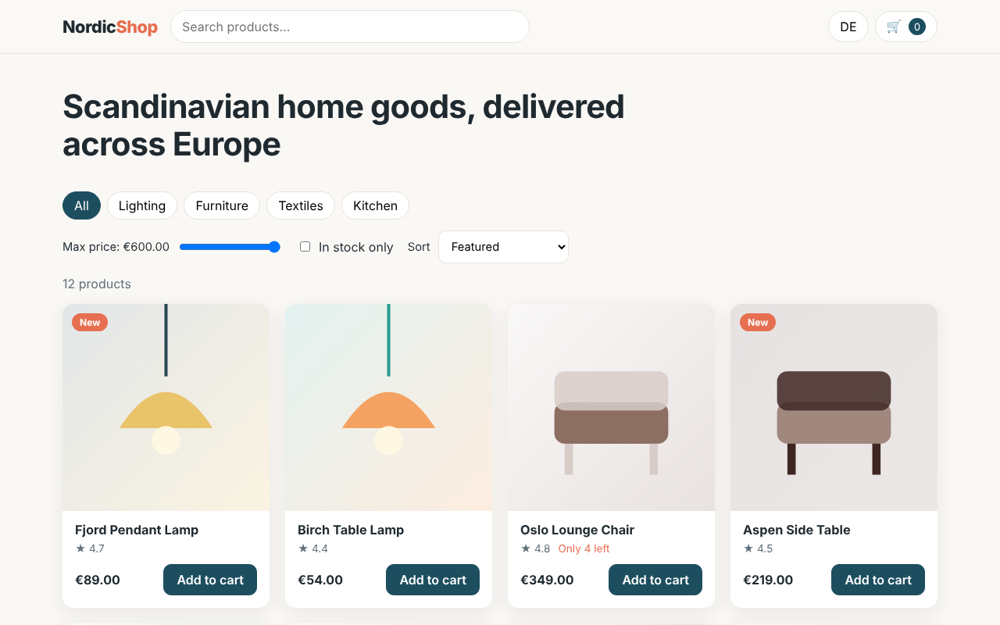
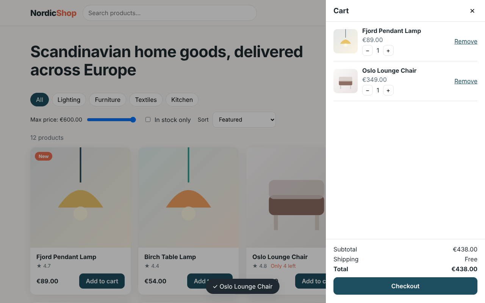
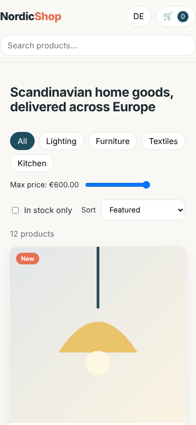

# Nordic Shop – React + TypeScript storefront

A fast, accessible e-commerce storefront: product catalog with search, filters and sorting, product details, a persistent cart with free-shipping progress, and a validated checkout – in English and German.

**[▶ Live demo](https://anton-simeon.github.io/nordic-shop/)**

| Desktop | Cart | Mobile |
|---|---|---|
|  |  |  |

## Features

- **Catalog:** live search, category chips, price range, "in stock only", sorting by price and rating
- **Product details** in a native `<dialog>` (focus handling and Esc for free)
- **Cart drawer:** quantity stepper limited by stock, remove, subtotal / shipping / total, free-shipping progress bar, saved in `localStorage`
- **Checkout:** client-side validation (required fields, e-mail, postal code), confirmation with order number
- **i18n:** EN / DE with locale-aware currency formatting (`Intl.NumberFormat`)
- **Accessibility:** semantic HTML, `aria-pressed` filter chips, `aria-live` result count, visible focus, `prefers-reduced-motion`
- **Performance:** no UI library, generated SVG artwork instead of heavy images, ~70 KB gzipped JS

## Tech

React 18 · TypeScript (strict) · Vite · Vitest · GitHub Actions → GitHub Pages

Business logic (cart, totals, filters, validation) lives in pure functions in [`src/cart.ts`](src/cart.ts) and is covered by unit tests in [`src/cart.test.ts`](src/cart.test.ts).

## Run locally

```bash
npm install
npm run dev        # http://localhost:5173/nordic-shop/
npm test           # unit tests
npm run build      # production build in dist/
```

## Project structure

```
src/
  App.tsx              page layout and state
  cart.ts              cart, totals, filtering, checkout validation (pure functions)
  cart.test.ts         unit tests
  data.ts              product catalog
  i18n.ts              EN / DE texts and currency formatting
  components/          ProductCard, Filters, ProductModal, CartDrawer, ProductArt
```

---

Built by [Volodymyr Anton-Simeon](https://github.com/Anton-Simeon) – Senior Frontend Engineer (React · Next.js · TypeScript).
